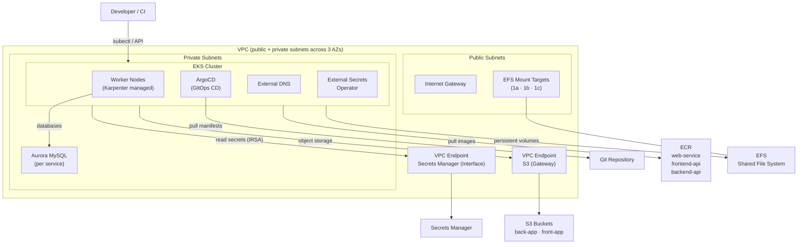

# AWS Simple EKS Environment

Terraform configuration for a production-oriented EKS environment on AWS. Includes VPC with private networking, EKS cluster with OIDC, Karpenter auto-scaling, ArgoCD, External Secrets Operator, ECR repositories, EFS persistent storage, Aurora MySQL databases, S3 buckets, and VPC endpoints for private AWS service access.

## Architecture



## Repository Structure

```
├── eks.tf              # EKS cluster module + OIDC + IAM roles (sm-role, oid-role, external-secrets)
├── vpc.tf              # VPC module + S3 VPC endpoint + Secrets Manager VPC endpoint
├── databases.tf        # Aurora MySQL clusters (one per service) + subnet group + security groups
├── ecr.tf              # ECR repositories (web-service, frontend-api, backend-api)
├── efs.tf              # EFS file system + mount targets across 3 AZs
├── s3.tf               # S3 buckets (back-app, front-app)
├── data.tf             # Data sources (OIDC policy docs, Secrets Manager)
├── main.tf             # Terraform backend (S3)
├── provider.tf         # AWS provider
├── vars.tf             # Input variables
├── dev.tfvars          # Dev environment variable values
├── storageclass.yml    # Kubernetes StorageClass for EFS/EBS
├── ebs-csi-policy.json # EBS CSI driver IAM policy
├── add-ons/
│   └── external-dns.yml     # ExternalDNS Helm values
├── argo/
│   ├── argoingress.yml      # ArgoCD ingress
│   ├── argogrpc.yml         # ArgoCD gRPC config
│   ├── argoui.yml           # ArgoCD UI config
│   └── iam_policy.json      # ArgoCD IAM policy
└── karpenter/
    └── provisioner.yml      # Karpenter node provisioner
```

## Prerequisites

- [Terraform](https://learn.hashicorp.com/tutorials/terraform/install-cli) installed
- [AWS CLI](https://docs.aws.amazon.com/cli/latest/userguide/getting-started-install.html) configured
- [kubectl](https://kubernetes.io/docs/tasks/tools/) installed
- S3 bucket for Terraform remote state
- Secrets Manager secret with database credentials

## Variables

| Variable | Description |
|----------|-------------|
| `env` | Deployment environment (e.g. `dev`, `prod`) |
| `cidr` | VPC CIDR block |
| `vpc-name` | VPC name |
| `cluster-name` | EKS cluster name |
| `k8s` | Kubernetes-specific config passed to VPC module |
| `mysql-dbs` | Map of MySQL database configurations per service |

## Usage

```shell
aws configure

terraform init -backend-config="bucket=<state-bucket>"
terraform plan -var-file=dev.tfvars
terraform apply -var-file=dev.tfvars
```

After the cluster is up, configure `kubectl`:

```shell
aws eks update-kubeconfig --name <cluster-name> --region us-east-1
```

Apply Kubernetes manifests:

```shell
kubectl apply -f storageclass.yml
kubectl apply -f argo/
kubectl apply -f add-ons/
kubectl apply -f karpenter/
```
